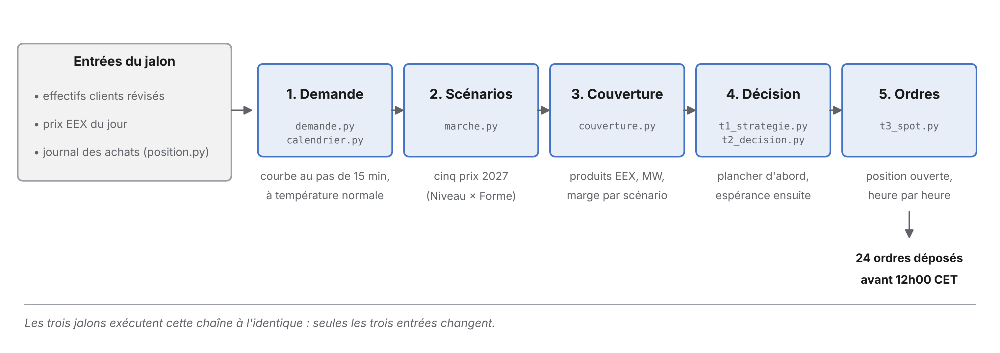

# Market Game 2027

Couverture d'un portefeuille de fourniture d'electricite pour l'annee de
livraison 2027 : 205 000 clients, un prix de vente impose de 95 EUR/MWh, et
trois rendez-vous pour acheter l'energie avant le 1er janvier.

EPF — MMMEE5SE16 « Marche de l'energie ».

## Lancer

Le depot contient le code **et** les donnees. Un clone frais tourne tel quel,
sans rien recuperer d'autre.

```bash
git clone https://github.com/Harille/YOR.git
cd "YOR/MarketGame/Version Light"
pip install pandas numpy matplotlib     # une seule fois
python lancer.py --figures
```

Trente secondes. Tout sort dans `sorties/`, qui est effacable sans risque.

Sans git : bouton vert **Code → Download ZIP**, puis les deux dernieres
commandes dans le dossier dezippe. Il faut Python dans les deux cas.

## Ce que ca calcule

| Jalon | Date | Decision |
| --- | --- | --- |
| **T1** | 22/09/2026 | 70 % du besoin en trimestres, 375 639 MWh a 87,55 EUR/MWh |
| **T2** | 01/12/2026 | completer a 100 % en Cal-27 a 73,70, 126 323 MWh |
| **T3** | 31/12/2026 | la centrale solaire met en sur-couverture : revente de 85 123 MWh |
| **Day-ahead** | 31/12/2026, 12h CET | les 24 ordres du 1er janvier 2027 |

Prix moyen paye sur l'ensemble : **84,06 EUR/MWh** pour 501 942 MWh.
Au 1er janvier, journee la plus chere de l'annee, le hedge success ressort a
**+0,80 EUR/MWh** — les prix de clearing publies par le prof sont integres.

## Comment ca marche

Les trois jalons executent la **meme** chaine de calcul. Seules trois entrees
changent d'un jalon au suivant : le nombre de clients revise par le service
commercial, les prix EEX du jour, et ce qui a deja ete achete. Les formules,
les probabilites et le critere de choix restent identiques — c'est ce qui rend
les trois jalons comparables entre eux.



| Etape | Module | Ce qu'elle produit |
| --- | --- | --- |
| 1. Demande | `outils/demande.py`, `outils/calendrier.py` | la courbe de charge au pas de 15 min, a temperature normale |
| 2. Scenarios | `outils/marche.py` | cinq prix 2027, construits en Niveau x Forme |
| 3. Couverture | `outils/couverture.py` | les produits EEX, les MW, la marge par scenario |
| 4. Decision | `t1_strategie.py`, `t2_decision.py` | le plancher d'abord, l'esperance ensuite |
| 5. Ordres | `t3_spot.py` | la position ouverte heure par heure, et les 24 ordres |

Deux points que le code protege explicitement. `outils/position.py` tient le
**journal des achats** : ce qui a ete achete a un jalon est un fait, il n'est
jamais recalcule, et une verification signale tout ecart avec ce que les
parametres actuels produiraient. Et le coefficient d'anticipation alpha est
fixe une fois pour toutes, identique pour tous les scenarios : le faire varier
reviendrait a retenir a chaque fois la valeur qui arrange.

La figure est regeneree par `docs/schema_algorithme.py`.

## Ou est quoi

Tout le projet est dans **`MarketGame/Version Light/`** :

- `t1_strategie.py`, `t2_decision.py`, `t3_spot.py` — un script par jalon,
  `lancer.py` les enchaine
- `outils/` — les cinq modules partages (demande, marche, couverture,
  calendrier, journal des operations)
- `donnees/` — les douze CSV du prof, deja versionnes
- `sorties/` — ce que chaque execution produit, figures comprises
- `rapport/` — quatre documents et quatre fiches condensees : les regles du
  jeu, la theorie du cours, le guide de lecture du code, tous les resultats.
  Voir `rapport/LISEZMOI.md`.
- `ordres_spot_1er_janvier_2027.xlsx` — le formulaire EPEX rempli

Le detail de chaque fichier, les parametres a changer et les limites assumees
du modele sont dans `MarketGame/Version Light/README.md` et dans `rapport/`.
